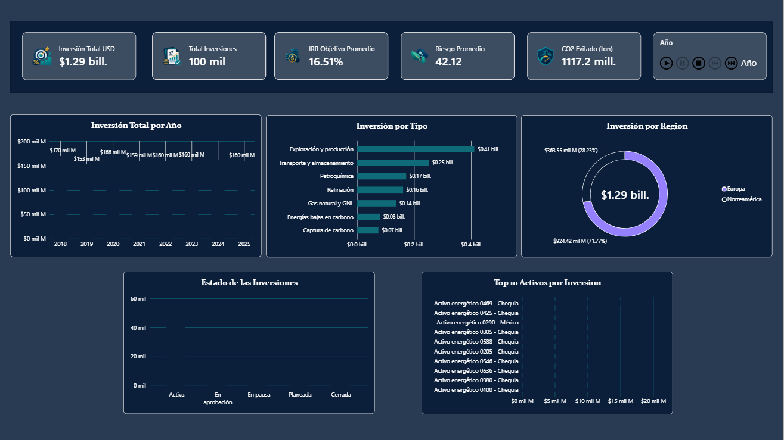
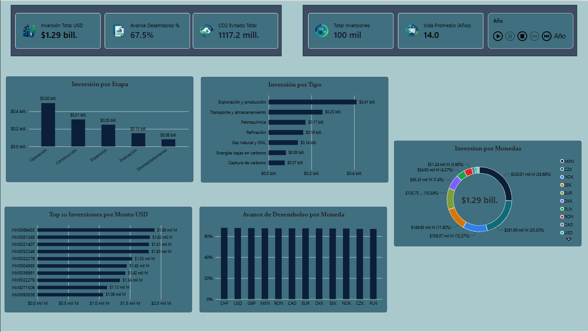
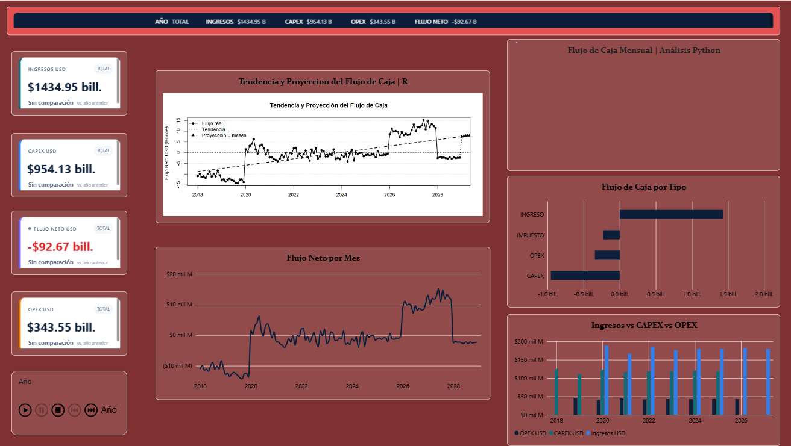
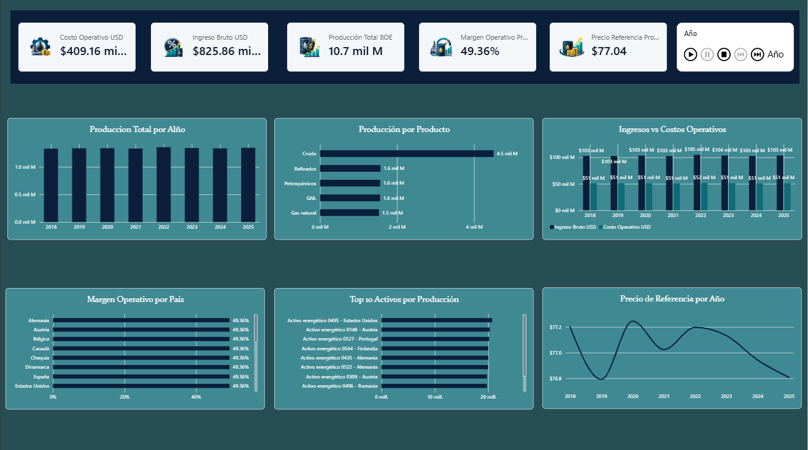
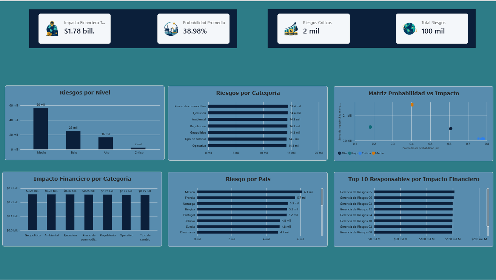
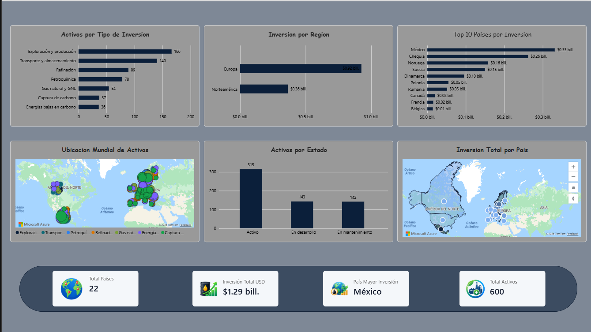
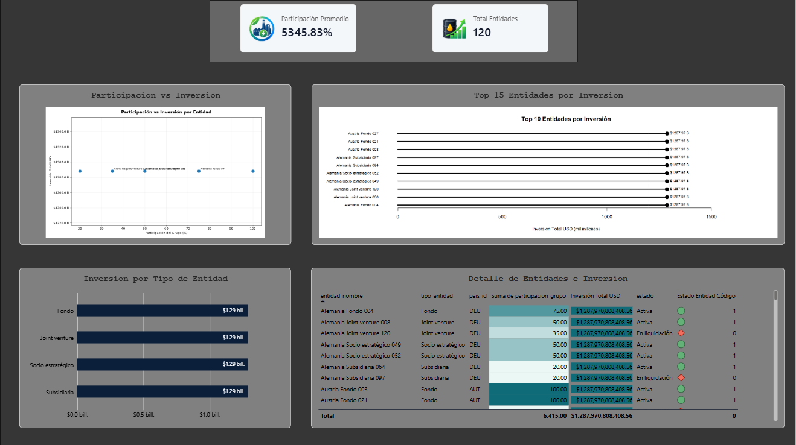
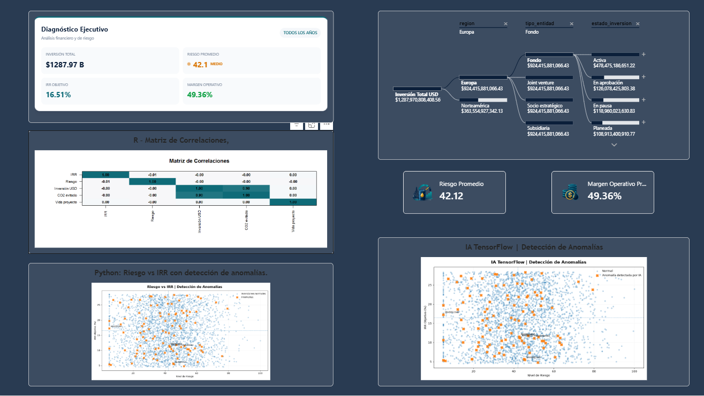

# Dashboard de inversiones petroleras

Proyecto de análisis y visualización de datos desarrollado por **David Aldana**, utilizando **PostgreSQL y Power BI**.

## Objetivo

Analizar inversiones y gastos operativos del sector petrolero, explorar su evolución y facilitar la consulta de indicadores mediante un reporte interactivo.

## Herramientas utilizadas

- **PostgreSQL:** almacenamiento y consulta de datos.
- **Power BI Desktop:** desarrollo del reporte y sus visualizaciones.

## Descargar el reporte

[Descargar inversiones.pbix — versión 1.0](https://github.com/david33-tech/powerbi-inversiones-petroleras/releases/download/v1.0/inversiones.pbix)

El archivo está disponible en la sección **Lanzamientos / Releases** del repositorio.

## Vista previa

### Página 1

### Página 2

### Página 3

### Página 4

### Página 5

### Página 6

### Página 7

### Página 8

## Cómo utilizar el reporte

1. Descarga el archivo inversiones.pbix desde el enlace anterior.
2. Ábrelo con Power BI Desktop.
3. Explora las páginas y utiliza los filtros disponibles.

Para actualizar los datos, configura la conexión a PostgreSQL con tu propio servidor, base de datos y credenciales. La base de datos no se incluye en esta descarga.

## Autor

**David Aldana**

[Ver perfil de GitHub](https://github.com/david33-tech)
